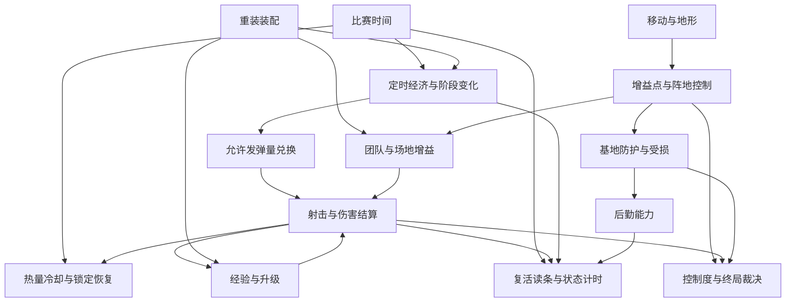

# 官方规则核对笔记

核对日期：2026-11-16。

依据：[《RoboMaster 2027 机甲大师高校超级对抗赛比赛规则手册 V1.0.0（20261015）》](F:/programming/RM/reference/RMUC_2027_Rule_Manual_V1.0.0_20261015.pdf)。以下页码为手册印刷页码。这份笔记记录已核对条款和项目决定，供后续实现查阅。

本次按全册章节浏览，并重点阅读第2、3、5、6章；场地、增益点和禁区结合图4-4、4-5、5-23、7-1核对。第5章比赛机制已逐节核对。细部尺寸、具体配置与临界条件在实现对应功能前回到原页确认。

## 全局认识与2027赛季变化

一局正式对抗持续7分钟。双方通过战斗、资源运营、升级、装配、争夺阵地和增益形成优势，推进至击毁基地；时间耗尽时按控制度、攻击伤害、存活机器人总血量等指标裁决。这些系统共同随比赛时间和事件更新。

2027赛季的重要变化见第13页：原英雄机器人与工程机器人合并为重装机器人；空中机器人调整为空中系统；原飞坡调整为隧道；新增自适应装甲和重装特殊机制；经济、飞镖、雷达等机制也有调整。地面阵容设计采用本赛季的重装、步兵、哨兵概念。

## 全部机制的导航

| 机制 | 大致作用与主要关联 | 参考页码 |
|---|---|---|
| 阵容与分工 | 重装负责装配、经济及条件解锁后的42mm输出；步兵使用17mm并通过经验升级；哨兵有自动/半自动配置与姿态系统。另有空中、飞镖、雷达组合系统 | 20-28 |
| 地图与通行 | 28m×15m中心对称场地，包含基地、启动区、补给区、工作台、堡垒、高地、公路、隧道、装配区等；地形与禁区共同约束位置与路线 | 29-61、133-134 |
| 攻击与伤害 | 区分弹丸口径、装甲和目标类型、有效检测、基础伤害；伤害受攻击、防御、易伤与自适应装甲等因素影响 | 64-65、72-73、103-105 |
| 发射与超限 | 每发消耗对应允许发弹量并产生热量；按时间冷却。速度超限、热量超限、模块离线等有各自的发射机构锁定条件 | 66-71、76-77 |
| 底盘功率 | 超出功率限制时消耗缓冲能量，缓冲能量耗尽后触发底盘断电；与移动机动能力关联 | 67-68 |
| 自适应装甲 | 每分钟获得可累积的加固机会，结合弹丸命中位置与相对精度划分加固区域，改变伤害倍率 | 72-73 |
| 生存与脱战 | 存活、战亡、异常离线、罚下、临时激活等具有不同效果；存活时连续6秒未发弹且未扣血进入脱战，关联远程兑换等条件 | 16-19、69-77、124-125 |
| 回血与复活 | 补给区、己方完全控制的前哨增益点和远程金币兑换可回血；读条或金币立即复活具有不同恢复比例与状态效果 | 73-76 |
| 金币与允许发弹量 | 队伍经济由初始金币、定时收入、装配收益等构成，用于发弹量、远程回血和立即复活；兑换方式、口径和时间影响费用及生效时机 | 75-88 |
| 重装与科技核心 | 取得能量单元、进入装配区并按难度完成装配，增加持续收入、提高等级上限、提供防御增益，并解锁42mm发射机构；工作台承担安装与拆分等操作 | 44-46、51-52、77-88、108 |
| 经验与配置 | 步兵通过发弹、伤害、击毁、能量机关及跨地形等事件获取经验；等级影响上限血量、功率、热量上限和冷却等属性；装配进度影响团队等级上限 | 89-94 |
| 前哨、基地与控制 | 阵地具有临时/完全控制状态，增益点争夺和击毁前哨站可改变控制关系；控制影响基地防护、前哨归属与重建、服务点可用性和控制度 | 94-97 |
| 后勤削减 | 基地受损会通过后勤系数影响复活读条、回血与信息能力，基地血量还会影响堡垒提供的冷却和储备发弹量 | 94-95、107 |
| 能量机关 | 前3分钟为小能量机关，之后为大能量机关；通过按序命中灯臂激活，提供限时防御、攻击、冷却与经验等收益，触发时机和效果随阶段与击打结果变化 | 97-101 |
| 场地增益 | 基地、制高点、中央高地、公路/隧道/高地跨越、前哨站、装配区、补给区和堡垒分别提供防御、冷却、回血、补弹、无敌等服务或增益，激活资格和持续方式各不相同 | 102-107 |
| 哨兵姿态 | 进攻、防御、移动姿态在冷却、功率、防御或易伤之间取舍；切换有冷却，累计时长影响效果，强化姿态另有时长限制；自动/半自动属性及指挥干预代价不同 | 25-26、108-110 |
| 飞镖 | 使用独立的闸门机会和目标检测窗口，目标模式影响伤害及额外效果；命中可影响经验、增益、界面、全队血量和基地护甲展开 | 65、110-111 |
| 雷达 | 标记地面机器人位置，标记精度和连续性推动进度，达到阈值产生易伤并积累双倍易伤机会；还可解析信息波与干扰波获取信息优势 | 112-114 |
| 空中系统 | 由机库和空中机器人组成，全自动执行攻击和侦察，存在独立通信与安全控制要求；其冲击可作为基地、前哨站伤害来源 | 27、65、129-131 |
| 赛制与裁决 | 局组成场，小组和淘汰赛采用相应BO赛制；基地被击毁可提前决胜，耗时后的比较顺序由第5.8节规定 | 19、114-115 |
| 比赛流程 | 检录、候场、3分钟准备、15秒自检、5秒倒计时、7分钟对抗、成绩确认和退场；技术暂停、重赛与申诉各有条件 | 116-122、136-141 |
| 违规与判罚 | 包括系统自动超限惩罚及人工口头警告、黄牌、红牌、判负等；禁区、冲撞、道具交互等有专门规则，罚下会影响复活资格 | 123-135 |

## 机制之间的主要联系

对项目的启示：后续需要把当前位置、生命值和资源接口，与比赛时钟、事件、阵营资源、设施控制状态逐步接起来。设计具体动作前，同时确认它的资格、资源代价、时间条件、目标状态、增益和对终局的影响。

## 官方条款

| 主题 | 条款与数据 | 页码 |
|---|---|---|
| 局与场 | 局包含准备、自检、倒计时和比赛阶段；一场可包含若干局 | 19 |
| 机器人类型与编号 | 重装1号、步兵3/4号、哨兵7号 | 20 |
| 比赛时间 | 正式对抗阶段为7分钟；时间耗尽或提前触发获胜条件时结束本局 | 121 |
| 基地与前哨站血量 | 基地10000，前哨站1000 | 94 |
| 基地防护 | 一方完全控制其己方前哨阵地时，该方基地获得100%防御增益；控制关系变化会影响该增益 | 94、96 |
| 前哨站重建 | 前哨阵地通过击毁前哨站完成完全控制权转换时，前哨站归新控制方所有，并以500血恢复存活 | 94、96 |
| 弹丸基础伤害 | 无增益时，17mm弹丸对机器人、基地装甲、前哨站中部装甲的原始伤害为20；42mm对应伤害为200 | 65 |
| 逐发计数 | 每发射1发弹丸，对应类型的允许发弹量减少1 | 76 |
| 射击热量 | 每发17mm增加10热量，每发42mm增加100热量；冷却按10Hz结算，每周期冷却量为每秒冷却值的1/10；超限会锁定发射机构 | 66、67 |
| 装甲检测间隔 | 17mm为50ms，42mm为200ms；此数据描述装甲检测间隔，射击调度另行确定 | 64 |
| 初始允许发弹量 | 重装、步兵为0；哨兵为300 | 22-25 |
| 初始金币 | 双方各800，随后按表5-6随比赛时间获得金币 | 75、76 |
| 复活途径 | 战亡后进行复活读条，读条过程中可用金币兑换立即复活 | 74 |
| 读条复活 | 恢复上限血量10%，并具有规则规定的虚弱、无敌状态 | 75 |
| 金币立即复活 | 恢复上限血量100%，先具有3秒虚弱与无敌状态；其他效果按原条款结算 | 75 |
| 立即复活费用 | ROUNDUP((420-比赛剩余秒数)/60)×80 + 机器人等级×20；ROUNDUP为向上取整到整数 | 76 |
| 补给区回血 | 基础速率为每秒上限血量10%；比赛开始4分钟后，脱战时为每秒25%；还受基地后勤系数影响 | 73、94、95 |
| 时间耗尽后的胜负 | 依次比较累计控制度、全队攻击伤害、存活机器人总剩余血量，仍一致则平局 | 114、115 |

## 机器人属性的配置依赖

- 重装开局默认上限血量400。属性随装配阶段变化；完成三级装配或成功安装模块化42mm发射机构后的上限血量为600。发射机构的安装、解锁条件见第108页。依据第91、92页表5-16。
- 步兵开局1级。1级功率优先底盘上限血量150，血量优先底盘为200；开局默认底盘为血量优先、发射机构为冷却优先。1级冷却优先发射机构热量上限40、冷却速率12/秒。依据第89、91-94页。
- 自动哨兵上限血量400、基础热量上限260、基础冷却速率30/秒；半自动哨兵分别为200、100、10/秒。姿态会进一步影响实际属性。依据第26、109页。
- 游戏初始化名单已采用重装开局默认、1级血量优先步兵、自动哨兵三种配置，并记录RobotType身份。对应的派生类能力差异后续实现；测试中的人工资源状态用于单独验证扣血、扣弹和额度处理。
- Robot已分别记录当前血量hp与血量上限MaxHp，提供GetHp()/GetMaxHp()读取；受伤结算保留血量上限，显示当前血量/上限血量。
- 开局资源检查已要求机器人当前血量等于血量上限、基地血量为10000、前哨站血量为1000；战斗中的受伤状态由运行阶段的逻辑处理。
- 第66页热量超限正文与第67页流程图在临界值Q1=Q2处的比较符号有差异；实现该临界情况前单独核对并记录采用的解释。

## 容易混淆、后续设计时分别记录的概念

1. **实际装载的弹丸与允许发弹量**：准备阶段可预装弹丸，开局允许发弹量按机器人类型给定；金币兑换主要增加允许发弹量。当前ammo已采用允许发弹量的含义，实际装弹的模拟方式后续确定。依据第17、22-26、75-77页。
2. **发射与命中**：发射触发发弹量消耗、热量及相关经验；装甲有效受击触发伤害。装甲检测间隔、发射机构的射击调度和热量冷却分别处理。依据第17、64-67、76、89页。
3. **前哨站本体与前哨阵地**：前者具有血量、归属与重建状态；后者由前哨站增益点和中央高地增益点构成，具有临时/完全控制状态。具体转换按表5-21逐条核对。依据第94、96页。
4. **基地防御增益与护甲形态**：100%防御增益受前哨阵地控制关系影响；基地还具有闭合/展开护甲形态，堡垒与飞镖规则提供展开条件。设计时分别记录两类状态及触发来源。依据第37-38、94、107、111页。
5. **科技核心与能量机关**：科技核心承担重装的能量单元装配任务，主要关联经济、等级解锁和团队防御；能量机关通过弹丸击打激活，主要提供限时增益和经验。依据第77-88、97-101页。
6. **步兵经验升级与重装装配成长**：步兵通过经验升到对应等级；重装通过装配收益改变等级、属性与发射机构权限。哨兵按自动/半自动与姿态获取不同性能。依据第26、83、89-94、108-110页。
7. **战亡与罚下**：血量为0可以来自不同原因；复活资格还与异常离线、罚下等状态关联，读条复活与金币复活也分别带有虚弱、无敌等效果。依据第16、73-75、125页。
8. **持续增益与临时增益**：持续激活的场地增益、跨地形临时增益、其他临时增益在离开区域、计时结束和战亡时具有不同处理方式。依据第103-106页。
9. **增益取值与叠加**：同类增益通常取最大效果，防御和易伤共同影响最终伤害；最终伤害、回血值按条款四舍五入。具体来源及例外回到相应表格核对。依据第103-105页。
10. **当前血量与上限血量**：回血、复活、升级、判罚等引用的基准不同，升级时上限提升的部分会添加到当前血量。依据第17、73-75、91、124页。
11. **官方时间与项目回合**：脱战、冷却、增益、占点、装配解锁、金币、复活和对抗结束均引用时间。项目回合与移动额度的更新需落到统一模拟时钟上。官方依据见第16、66、73-77、82-83、96-110、121页；回合和AP属于已确认的项目设计。

## 已确认的项目决定

- 地图坐标以左上角为原点，x向右、y向下，单位为米，边界为[0,28]×[0,15]。
- 使用简化固定站位：红基地(2,7.5)、蓝基地(26,7.5)、红前哨站(11,11.5)、蓝前哨站(17,3.5)。
- 每方初始化名单：重装1号，400血、允许发弹量0；1级血量优先步兵3号，200血、允许发弹量0；自动哨兵7号，400血、允许发弹量300。当前移动行动点初值为项目设定的3。
- ammo字段采用允许发弹量的含义，后续兑换和逐发消耗围绕该含义实现。
- 基地、前哨站等固定设施由地图布局给出坐标；初始化占位检查覆盖机器人之间、机器人与基地/前哨站之间的中心坐标重合。
- 项目保留任务书要求的回合和回合上限；移动行动点用于约束移动。
- 已确认时间映射：每个逻辑步推进0.1模拟秒，10步组成1秒的移动回合；每局420秒，共4200个逻辑步、420个移动回合。第1回合从0秒开始，每个新回合刷新移动额度；到420秒执行终局处理。逻辑步频率与各机器人射击频率分别配置。
- 射击与移动行动点独立，射击相关结算接入弹药、热量和模拟时间。
- 金币复活等操作按各自条件和资源结算，移动行动点消耗可为0。
- TryConsumeActionPoints(0)返回true并保留原额度，包含原额度为0的情况；负数或额度不足返回false并保留原额度。

## 后续实现时需要明确的映射

- 回合边界的事件顺序、复活后的移动额度，以及420秒终局时最后一个逻辑步的结算顺序。
- 实际装载弹丸的项目表示方式，以及允许发弹量的金币兑换流程。
- 已选机器人配置基础上的热量、装配/升级、发射机构权限和哨兵姿态。
- 防护、前哨阵地控制、复活与增益采用的项目规则，并分别记录官方依据和简化决定。
- 同一模拟时间步内，移动、射击、伤害、死亡、设施控制变化、经济更新、状态计时和终局检查的事件顺序。
- 进入项目的机制逐项依据任务书和已确认设计安排；采用的官方参数按具体机器人配置、等级、阶段和条款填写。

## 后续带教时的查阅顺序

1. 先确定要实现的比赛行为和现有状态，再查本笔记的机制导航。
2. 回到原手册对应页，阅读完整条款、表格、图示、脚注及关联章节。
3. 给出官方依据、配置条件和当前项目决定，明确输入、结果与时间/资源影响。
4. 学生编写新的核心逻辑；重复适配与测试沿用当前分工。
5. 用实际保存的代码和可复现测试验收，再继续下一个功能。
6. 助手修改同一源码前核对编辑器未保存备份；遇到编辑器与磁盘版本差异时先保留两版，再合并并重新载入结果。
